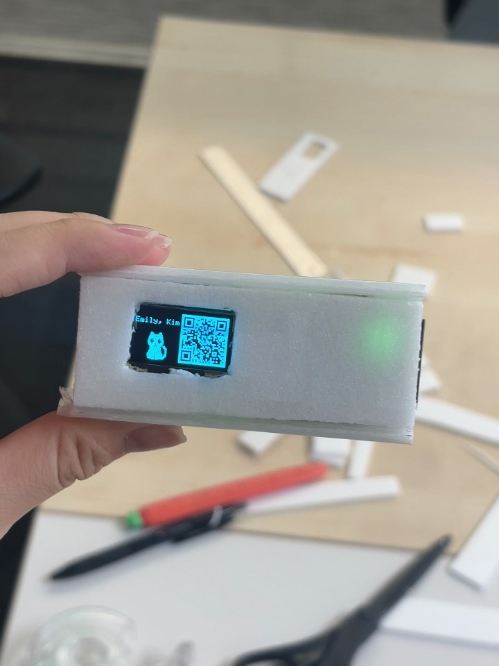

# NU40 DK 고양이 명함 키링

**흔들면 화면이 켜지고**, 1비트 고양이가 걸어 나와 "Hi!" 하고 인사한 뒤 앉아서
내 이름과 **QR 코드**를 띄우는 디지털 명함 키링입니다. 처음 만난 사람에게 가방에 달린 키링을 흔들어 보여 주면 끝.




```
꺼짐 (화면 off, 가속도 센서로 흔들기만 감시)
 └ 흔들기 (1초 안에 3번)
     → 고양이가 걸어 나와 "Hi!" → 왼쪽에 앉기 → 이름 한 글자씩 → QR 위에서 아래로
       └ 명함 표시 (눈 깜빡임, 또 흔들면 30초 다시 셈)
           └ 30초 → 엎드려 잠듦 → 화면 꺼짐 → 처음으로
```

고양이는 기존 그림을 쓰지 않고 파이썬에서 도형으로 직접 그린 **오리지널 스프라이트**입니다.

## 들어간 것

| 부품 | 역할 |
|---|---|
| NUCODE **NU40 DK** (nRF52840) | 연출 · 흔들기 판정 |
| SSD1306 0.96" OLED 128×64 (I2C `0x3C`) | 화면 |
| LSM6DS3TR-C 가속도/자이로 (I2C `0x6A`) | 흔들기 감지 |
| LiPo 배터리 | 보드 커넥터에 직결 |
| 폼보드 케이스 + 키링 고리 | 손으로 잘라 붙임 |

## 배선

OLED 와 IMU 가 같은 I2C 버스(400kHz)를 같이 씁니다.

| 신호 | NU40 DK |
|---|---|
| SDA | **P0.26** |
| SCL | **P0.27** |
| VCC | **3V3** (5V 금지) |
| GND | **GND** |

보드·핀 정리는 [HARDWARE.md](HARDWARE.md).

## 폴더

```
preview/              PC 미리보기 · 에셋 만들기 (파이썬)
  cat_sprites.py      고양이 스프라이트 (도형으로 그림 — 고치기 쉬움)
  preview.py          128×64 연출 미리보기 → out/demo.gif, stages.png, card.png
  qr_gen.py           QR 만들기 (segno) → cat_qr.h
  export_sprites.py   스프라이트 → 펌웨어용 cat_bitmaps.h
firmware/
  i2c_scan/           I2C 장치 주소 찾기
  oled_imu_test/      OLED 표시 + IMU 값 확인 + 보정
  card_static/        정지 명함 (이름 + 고양이 + QR)
  intro_anim/         등장 연출
  shake_wake/         ★ 최종 — 흔들어 켜기 + 30초 뒤 잠들기
```

단계별로 하나씩 올려 보며 만들었기 때문에, 처음 만든다면 위에서부터 차례로 구워 보면 됩니다.

## 굽기

보드 매니저에 NUCODE nRF52 코어가 필요합니다 (URL 은 [HARDWARE.md](HARDWARE.md)).
라이브러리는 **Adafruit SSD1306 + Adafruit GFX**.

```sh
cd firmware
arduino-cli compile --fqbn nucode:nrf52:nu40dk shake_wake
arduino-cli upload  --fqbn nucode:nrf52:nu40dk -p /dev/cu.usbmodemXXXX shake_wake
```

시리얼(115200)로 `r` = 연출 다시 보기, `s` = 바로 끄기.

## 내 명함으로 바꾸기

1. **이름**: `firmware/shake_wake/shake_wake.ino` 맨 위 `OWNER_NAME`. OLED 기본 글꼴이라 **영문만** 됩니다.
2. **QR**: `preview/qr_gen.py` 의 `QR_URL` 을 내 링크로 바꾸고 실행 → 나온 `cat_qr.h` 를 펌웨어 폴더로 복사.
   짧은 주소일수록 QR 이 작고 또렷해집니다 (지금은 29×29, 폰으로 스캔 확인).
3. **고양이 모양**: `preview/cat_sprites.py` 고치고 `export_sprites.py` 실행 → `cat_bitmaps.h` 복사.

## 조절값 (`shake_wake.ino` 맨 위 · `imu_calibration.h`)

| 값 | 뜻 | 기본 |
|---|---|---|
| `SHAKE_THRESHOLD` | 흔들기 민감도 (낮을수록 민감). 가방에서 혼자 켜지면 0.45~0.6 | 0.35 |
| `SHAKE_COUNT` / 창 | 1초 안에 몇 번 흔들어야 켜지나 | 3 / 1000ms |
| `SHOW_TIMEOUT_MS` | 명함 띄워 두는 시간 | 30000 |
| `T_WALK_IN` / `T_WALK_LEFT` | 걸어 나오는 속도 | 2200 / 1500 |

`SHAKE_THRESHOLD` 와 IMU 보정값은 `imu_calibration.h` 에 있습니다. 보드를 평평하게 두고 `oled_imu_test` 를 구운 뒤 시리얼로 `c` 를 보내면 새 값을 찍어 줍니다.

## 더 해 볼 것 — 저전력 대기

지금은 꺼져 있을 때도 IMU 를 약 100Hz 로 계속 읽어서 배터리를 씁니다.
IMU 인터럽트 핀을 **P1.00** 에 연결하고, LSM6DS3 의 wake-up 인터럽트 + nRF52840 **System ON sleep** 으로
자다가 흔들리면 깨어나게 하면 대기 전력을 크게 줄일 수 있습니다.
